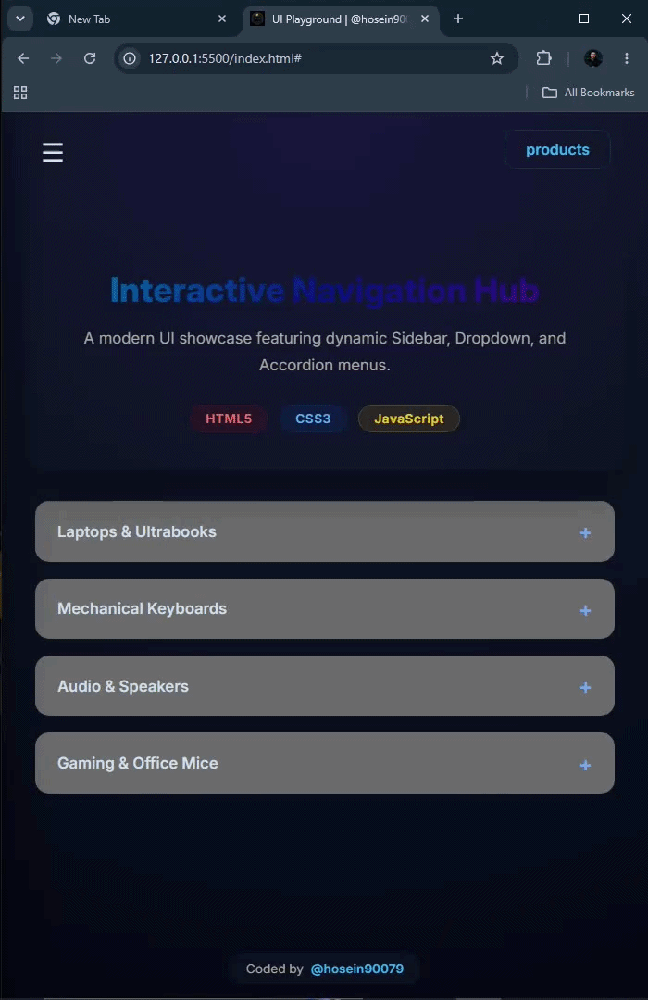

# UI-Playground
Responsive UI component showcase with Glassmorphism design, featuring interactive accordion menus and clean CSS architecture.

## Features
- **Responsive Layout:** Works smoothly on desktop and mobile devices.
- **Glassmorphism Design:** Modern UI with blurred background effects.
- **Interactive Components:** Accordion navigation, overlay menus, and more.
- **Tech Stack:** HTML5, CSS3 (Flexbox), and Vanilla JavaScript.

## Preview

## About
This project was built to master CSS layouts and DOM manipulation. Focus was placed on writing semantic HTML and maintaining a clean, maintainable folder structure.

---
*Coded by [@hosein90079]*
